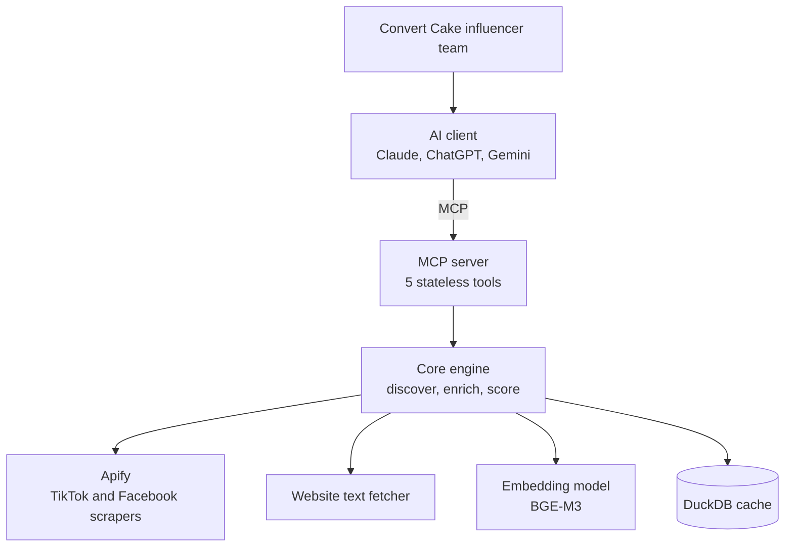

# TikTok KOL Matcher for the Thai Market

An MCP server that lets any AI client (Claude, ChatGPT, Gemini, or any other MCP-compatible assistant) find and evaluate Thai TikTok creators and KOLs for a brand, starting from the brand's Facebook page and website.

> **Positioning:** this server is the bridge between AI clients and TikTok influencers/KOLs.
> The AI client does the reasoning. The server does the measurement.

Built for the Convert Cake AI Engineer assessment.

**Demo video:** _Loom link (TBD)_

---

## Overview

Convert Cake's influencer marketing team needs a faster way to match clients with relevant TikTok creators in Thailand. This project covers the four requirements of the brief:

| Requirement | How it is covered |
|---|---|
| 1. Analyze the client's Facebook page and website | `analyze_brand` collects page details, recent posts, and website text. The AI client summarizes them into a validated `BrandProfile`. |
| 2. Identify and evaluate relevant Thai TikTok creators/KOLs | The AI client proposes search angles. `search_creators` discovers and filters Thai creators. `evaluate_creators` measures how well each one fits. |
| 3. Rank by relevance, engagement, and audience | A deterministic weighted score built from relevance, performance, audience (inferred), and credibility, weighted by the campaign objective. |
| 4. Present a curated list with profile information | Ranked results with TikTok profile links, metrics, score breakdowns, evidence clips, and flags. `save_shortlist` exports a CSV. |

A **KOL (Key Opinion Leader)** is a creator with recognized expertise in a field, such as a dermatologist recommending skincare, whose recommendations carry more weight with their audience. The matcher detects self-declared expertise and flags it for verification.

## How it works



<!-- Full diagram: export the draw.io file to docs/architecture.png and link it here. -->

### Workflow

| # | Step | Owner | Tool |
|---|---|---|---|
| 1 | Input the client's Facebook page and/or website | User | |
| 2 | Collect brand data | Server | `analyze_brand` |
| 3 | Summarize the data into a `BrandProfile` and confirm it with the user | AI client | |
| 4 | Generate search queries (Thai/English keywords, hashtags) | AI client | |
| 5 | Discover Thai creators | Server | `search_creators` |
| 6 | Enrich creators and compute features | Server | `evaluate_creators` |
| 7 | Rank with a deterministic score | Server | `evaluate_creators` |
| 7.5 | Review evidence and judge qualitative fit; return to step 4 if the pool is weak | AI client | `get_creator_detail` |
| 8 | Present recommendations to the user | AI client | |
| 9 | Save the approved shortlist | Server | `save_shortlist` |

The server enforces everything that must stay consistent: data collection, Thai-creator filtering, budgets, and scoring. The AI client handles the work that benefits from reasoning: summarizing the brand, proposing creative search angles, and judging qualitative fit from evidence.

## MCP tools

| Tool | Parameters | Returns |
|---|---|---|
| `analyze_brand` | `facebook_url?`, `website_url?` | Cleaned page details, recent posts, website text, and the `BrandProfile` JSON Schema for the AI client to fill in |
| `search_creators` | `profile`, `queries[]?` | Thai candidates, the query that found each one, and `profile_hash`. Without `queries`, the profile's keywords and hashtags are used. |
| `evaluate_creators` | `profile`, `handles[]`, `objective`, `top_n?` | Top `top_n` (default 3) creators in full: score breakdown, metrics, evidence clips, flags. The rest of the ranking as handles and scores, plus `profile_hash`. Evaluate up to 5 handles per call (configurable). |
| `get_creator_detail` | `handle` | Recent captions, clips, and raw metrics from the cache |
| `save_shortlist` | `profile`, `handles[]`, `objective`, `notes?` | A CSV built from server data. The selection is written to the shortlist log. |

- `handles` are TikTok usernames.
- Every tool is **stateless**. The AI client passes the `BrandProfile` on each call, and tools return a `profile_hash` so changes between calls can be detected.
- `save_shortlist` recomputes metrics from the cache instead of accepting numbers from the AI client, so exported figures always come from the server.

### `BrandProfile` example

```json
{
  "brand_name": "Example Running Co.",
  "category": "sportswear",
  "products": ["running shoes for beginners"],
  "price_tier": "mid",
  "target_audience": "Thai adults aged 25-40 who are starting to run",
  "tone": "encouraging, practical",
  "content_themes": [
    "beginner running training",
    "choosing running shoes",
    "healthy active lifestyle"
  ],
  "keywords_th": ["วิ่งมือใหม่", "รองเท้าวิ่ง", "ซ้อมวิ่ง"],
  "keywords_en": ["beginner running", "running shoes"],
  "hashtags": ["#วิ่ง", "#runnerth"],
  "competitors": ["<competitor brand>"],
  "target_tiers": ["micro", "mid"]
}
```

The schema uses field descriptions, enums, and length limits (for example, at most five content themes) so that any AI client produces a consistent profile. Every tool validates the profile on input and returns a clear error if a field is invalid.

## Scoring

Each creator is scored on their own numbers: every metric goes through a fixed scale to 0-1 (anchors in `core/scoring.py`, tuned with the backtest), so a score does not depend on which other creators are in the same call and is comparable across calls.

| Component | Signals | Basis |
|---|---|---|
| Relevance | Embedding similarity between brand themes and each clip (mean of the top 3), combined with niche consistency (share of clips on-theme) | measured |
| Performance | Engagement rate by impression (content quality) and impressions per follower (reach proxy). Definitions follow [Wisesight](https://wisesight.com/th/articles/what-is-engagement/): Engagement = likes + comments + shares + saves; Impression = plays. Engagement rate by follower is reported but not scored, since it is roughly the product of the two scored metrics. Reach (unique viewers) is not public on TikTok. | measured |
| Audience | Share of Thai-language comments and rate of purchase-intent comments (e.g. "พิกัด", "ซื้อที่ไหน") | **inferred** |
| Credibility | View consistency, posting recency, sponsored-content ratio, duplicate or emoji-only comments | measured |

The final score is a weighted sum. Weights depend on the campaign objective:

| Objective | Relevance | Performance | Audience | Credibility |
|---|---|---|---|---|
| `awareness` | 0.25 | 0.45 | 0.15 | 0.15 |
| `engagement` (default) | 0.35 | 0.30 | 0.20 | 0.15 |
| `conversion` | 0.30 | 0.20 | 0.35 | 0.15 |

These are initial weights, tuned with the backtest in `evals/`.

**Relevance gate:** creators with relevance below 0.25 rank after every on-topic creator, whatever their total, and carry a `low_relevance` flag. Without it, large off-topic accounts (comedy, travel) reached the top 10 on performance alone. Each creator is measured on their 10 most recent clips.

**Tiers:** nano (<10K followers), micro (10K-100K), mid (100K-500K), macro (500K-1M), mega (1M+). Both scored performance metrics are ratios (per impression, per follower), so micro creators are not buried by mega creators' raw view counts.

**Flags** are shown for human review and are not part of the score:

- **Inactive:** no posts in the last 60 days. This is also a hard filter.
- **Brand safety:** risky keywords in captions or bio, such as online gambling terms.
- **Competitor mention:** recent captions mention a brand listed in `competitors`.
- **Self-declared expertise:** professional titles in the bio (e.g. นพ., พญ., ภก., Dr.), labelled *unverified*.
- **High sponsored ratio:** a large share of recent posts are ads.
- **Low relevance:** few clips match the brand themes; ranked after on-topic creators (see the relevance gate).

Each result includes a short rationale generated from templates over the computed features, for example: *"72% of clips match 'beginner running training'; engagement rate above 85% of micro creators."*

Audience demographics are not publicly available, so the audience score is a proxy and is always labelled `inferred`.

## Design decisions

- **The AI client reasons; the server measures.** The engine contains no LLM. Brand summarization and query ideation happen in the AI client, which keeps the server model-agnostic, free of LLM costs, and reproducible. The trade-off is that profile quality depends on the client's model. A strict schema, validation, and user confirmation mitigate this.
- **Stateless tools.** Each tool works only from its inputs. This makes tools easy to test, makes backtests exactly repeatable with saved profiles, and lets a hosted server scale without session affinity.
- **Deterministic ranking, no LLM judge.** Scores come from formulas, so the same inputs always produce the same ranking. Qualitative judgment happens in the AI client, where the user can see and question it.
- **Cache-first, append-only snapshots.** Every external call is cached in DuckDB, which controls cost, enables offline demos, and builds a history for future growth tracking.
- **No vector database.** Each evaluation compares a known pool of a few thousand clips, so a matrix multiplication is enough.
- **A plain Python workflow, not an agent framework.** The pipeline is well defined, so it is written as ordinary code. Agentic behavior lives in the AI client, following the workflow-versus-agent distinction in Anthropic's *Building effective agents*.
- **Why not just connect an AI client to Apify's MCP server?** Apify provides raw scraping. This server adds the domain layer: Thai-creator filtering, feature engineering, consistent scoring, caching, and budget control. The baseline comparison in `evals/` measures the difference.

## Tech stack

| Area | Choice |
|---|---|
| Language and packaging | Python 3.13+, uv |
| MCP server | FastMCP (stdio; streamable HTTP planned) |
| Schemas and settings | Pydantic v2, pydantic-settings |
| TikTok and Facebook data | Apify (`apify-client`): Facebook Pages and Posts scrapers, a TikTok scraper with keyword search, and a TikTok comments scraper used only for top candidates |
| Website text | httpx, trafilatura |
| Cache and storage | DuckDB |
| Feature computation | DuckDB SQL, numpy |
| Embeddings | BGE-M3 via Ollama, behind a provider interface |
| Thai text signals | Unicode-range regex and substring matching |
| CLI | Typer |
| Testing and linting | pytest, ruff |

## Getting started

### Prerequisites

- [uv](https://docs.astral.sh/uv/). uv installs the required Python version automatically.
- An [Apify](https://apify.com) API token (live mode only)
- [Ollama](https://ollama.com) with the `bge-m3` model (live mode only; replay mode uses cached embeddings)
- An MCP client such as Claude Desktop, or the MCP Inspector for testing

### Installation

```bash
git clone <repository-url>
cd tiktok-kol-matcher
uv sync
cp .env.example .env
```

### Configuration

Edit `.env`:

```dotenv
APIFY_TOKEN=                      # required for live mode
CACHE_PATH=data/cache.duckdb
REPLAY_MODE=false                 # true = serve fixtures only, no external calls
EMBEDDING_PROVIDER=ollama
OLLAMA_BASE_URL=http://localhost:11434
EMBEDDING_MODEL=bge-m3
MAX_RESULTS_PER_QUERY=30
MAX_CREATORS_PER_EVALUATE=5
```

### Connect to Claude Desktop

Add the server to `claude_desktop_config.json`:

- macOS: `~/Library/Application Support/Claude/claude_desktop_config.json`
- Windows: `%APPDATA%\Claude\claude_desktop_config.json`

```json
{
  "mcpServers": {
    "kol-matcher": {
      "command": "uv",
      "args": [
        "--directory",
        "/absolute/path/to/tiktok-kol-matcher",
        "run",
        "kol-matcher-server"
      ]
    }
  }
}
```

Restart Claude Desktop. The five tools appear under the `kol-matcher` server.

For the recommended conversation flow, add `skills/kol-matcher/SKILL.md` as a skill in your AI client.

### Test with the MCP Inspector

```bash
npx @modelcontextprotocol/inspector uv --directory . run kol-matcher-server
```

### Offline demo (no API keys)

Set `REPLAY_MODE=true` in `.env`. The server and CLI then serve only the committed data in `fixtures/` and make no external calls.

## Usage

### With an AI client

1. Ask: *"Find TikTok creators for https://www.facebook.com/&lt;brand&gt; and https://&lt;brand&gt;.com. The goal is conversion."*
2. The client calls `analyze_brand`, drafts a `BrandProfile`, and asks you to confirm it.
3. After you confirm, it calls `search_creators` with its query ideas, then `evaluate_creators`.
4. It reviews evidence for the top creators with `get_creator_detail` and presents a shortlist with reasons.
5. Ask it to save the creators you approve. `save_shortlist` returns a CSV.

### With the CLI

```bash
# Collect raw brand data
uv run kol-matcher analyze --facebook-url https://www.facebook.com/<page> --website-url https://<site>

# Run the full pipeline with a saved profile (queries come from the profile's keywords)
uv run kol-matcher match --profile fixtures/profiles/example.json --objective engagement --out shortlist.csv

# Backtest against known past collaborations
uv run kol-matcher backtest --profile fixtures/profiles/example.json --ground-truth evals/ground_truth/example.csv --k 20
```

## Evaluation

There is no labelled ground truth for "good matches", so the project uses two measurable proxies.

- **Backtest:** pick a Thai brand with past TikTok creator collaborations. The ground truth is the set of creators who posted sponsored content for that brand. The brand's name is excluded from search queries, and the metric is recall@K: how many of those creators appear in the top K.
- **Baseline comparison:** run the same brief with an AI client connected only to raw Apify tools, then compare recall@K, consistency across three runs, time, and cost.
- **Query-source experiment:** compare default profile queries with AI-proposed queries, using three runs to measure variance.

First run, Srichand (38 known collaborators, K = 10, pool 20). Details in `evals/README.md`.

| Setup | Recall@10 | Off-topic creators in top 10 | Consistency (3 runs) | Time | Cost |
|---|---|---|---|---|---|
| This server v1 (30 clips, no gate, pool 20) | 0.00 (0/38) | 2 (comedy, travel) | Deterministic on cache | ~18 s cached; cold not measured | $2.90 |
| This server v2 (10 clips, relevance gate, pool 12) | 0.00 (0/38) | 5 flagged, ranked after on-topic | Same data: identical. Fresh scrapes: 4-5 of 10 shared (search changes) | <1 s cached; 101-155 s cold | $1.35 |
| This server v2, AI-proposed queries | 0.00 (0/38) | 3 flagged, ranked after on-topic | 1 run only | 116 s cold | $1.27 |
| AI client + raw Apify tools (Claude) | 0.00 (0/38) | 0 | 1 run only (budget) | ~4 min | $1.02 |

## Ethics and privacy

- **Public data only.** No logged-in scraping and no private data.
- **Data minimization (Thailand PDPA).** Public creator data is still personal data. The project stores only the fields it uses, applies a retention period, and supports deletion on request.
- **Commenter privacy.** Only aggregated comment statistics are stored. Commenter identities are never saved.
- **Honest labelling.** Every metric is marked `measured` or `inferred`. No sensitive attributes, such as age, gender, religion, or health, are inferred about any individual.
- **Prompt-injection resistance.** Scraped text (bios, captions, comments, website copy) is returned in clearly separated fields. Hard filters and scores are computed deterministically and cannot be changed by text in that content.
- **Fairness across tiers.** Performance uses ratios (per impression, per follower), not raw counts, so smaller creators are not buried by large accounts.
- **Human decision.** The tool recommends and explains; the influencer team makes the final choice.
- **Cost guardrails.** Per-call limits and cache-first access prevent runaway scraping costs from AI agents.
- **Platform terms.** Third-party scraping carries terms-of-service risk. TikTok's Research API is restricted to non-commercial academic research. The production path is an official partner integration, such as the TikTok Creator Marketplace API, which also provides first-party audience demographics.

## Limitations

- TikTok captions are short and sometimes contain only hashtags, which limits relevance signals. Video transcripts would improve this.
- Audience demographics are inferred, not observed.
- Scrapers can break when TikTok changes its site. Pinned actor builds and replay mode reduce demo risk.
- Cached metrics go stale; each row records `scraped_at`, and refresh intervals are configurable.
- Profile quality depends on the AI client's model.
- The ask-before-search confirmation step relies on the skill and the client's tool-approval prompts; the server cannot verify that a human confirmed.

## Roadmap

- A scheduled creator index refresh, using append-only snapshots for growth tracking and anomaly detection
- Video transcripts (Thai speech recognition) for stronger relevance signals
- Learning-to-rank from shortlist feedback and campaign results
- Lookalike search ("find creators like @x") across the creator index
- Competitor-conflict checks based on recent sponsored content
- MCP Apps for an interactive shortlist table inside the chat
- MCP elicitation, so users confirm the brand profile directly in the client
- A hosted remote MCP server with per-customer OAuth and isolated private data, plus a REST API for platforms without MCP
- Official data sources to replace scraping in production

## Business impact

- **Speed:** a first shortlist in minutes instead of hours of manual browsing, so account teams can bring creator options to the first client meeting.
- **Consistency:** the same scoring for every client and every team member, with evidence attached to each recommendation.
- **Compounding value:** each search grows the creator cache, and each saved shortlist becomes feedback data that improves future rankings.
- **Distribution:** customers connect their own AI client (Claude, ChatGPT, or Gemini). This supports a subscription with usage-based quotas, since the main variable cost is data collection.

## Project structure

```
tiktok-kol-matcher/
├── src/kol_matcher/
│   ├── core/         # Matching engine (no MCP dependency)
│   ├── schemas/      # Shared Pydantic contracts, including BrandProfile
│   ├── sources/      # Apify and website adapters (cache-first)
│   ├── storage/      # DuckDB cache, snapshots, embeddings, shortlist log
│   ├── tools/        # MCP tool adapters, one file per tool
│   ├── config.py     # Settings from .env
│   ├── server.py     # MCP server entry point
│   └── cli.py        # CLI entry point
├── skills/           # SKILL.md describing the workflow for AI clients
├── evals/            # Backtest and baseline comparison
├── fixtures/         # Committed demo data for offline replay
├── tests/            # Unit and contract tests (mirrors src/)
├── docs/             # Diagrams and design notes
└── data/             # Local cache (git-ignored)
```

Imports flow one way, `tools → core → sources / storage`, and `schemas` is shared by every layer.

## References

- Model Context Protocol: https://modelcontextprotocol.io
- FastMCP: https://gofastmcp.com
- MCP Inspector: https://github.com/modelcontextprotocol/inspector
- MCP Apps: https://github.com/modelcontextprotocol/ext-apps
- Apify TikTok Data Extractor: https://apify.com/clockworks/free-tiktok-scraper
- Apify TikTok Scraper: https://apify.com/clockworks/tiktok-scraper
- Apify Facebook Pages Scraper: https://apify.com/apify/facebook-pages-scraper
- Apify Facebook Posts Scraper: https://apify.com/apify/facebook-posts-scraper
- BGE-M3: https://huggingface.co/BAAI/bge-m3
- Ollama: https://ollama.com
- DuckDB: https://duckdb.org
- uv: https://docs.astral.sh/uv/
- trafilatura: https://trafilatura.readthedocs.io
- Anthropic, *Building effective agents*: https://www.anthropic.com/research/building-effective-agents
- Agent Skills specification: https://agentskills.io
- TikTok Research API FAQ: https://developers.tiktok.com/doc/research-api-faq
- TikTok Creator Marketplace API (TechCrunch): https://techcrunch.com/2021/08/31/tiktoks-new-creator-marketplace-api-lets-influencer-marketing-companies-tap-into-first-party-data